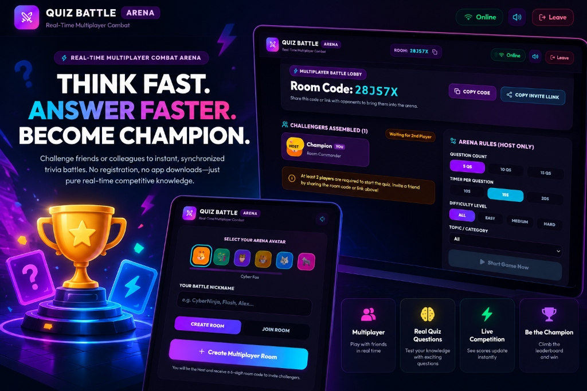

<div align="center">



# ⚔️ Quiz Battle Arena

**Think Fast. Answer Faster. Become the Champion.**

[](https://quiz-battel-arena.vercel.app/)
[](https://github.com/Chandra142/Quiz-Battel-Arena)
[](https://opensource.org/licenses/MIT)

</div>

---

## 🎮 About The Project

**Quiz Battle Arena** is a real-time multiplayer trivia game built for friends and classmates to compete head-to-head. 

Create a room, share your 6-digit code or invite link, and battle live with synchronized timers, live leaderboards, sound effects, and instant scoring! No login or downloads required.

🔗 **Play Live**: [https://quiz-battel-arena.vercel.app/](https://quiz-battel-arena.vercel.app/)

---

## ✨ Features

- **Multiplayer Battles**: Real-time room creation with unique 6-character room codes.
- **Synchronized Timers**: Everyone sees the exact same questions and timers at the same time.
- **Fair Scoring Engine**: Faster correct answers earn more points (up to 500 bonus points).
- **Streak Bonus**: Answer multiple questions correctly in a row for extra multiplier points.
- **Live Leaderboard**: Real-time ranks, animated score updates, and position changes.
- **3D Victory Podium**: Winner celebrations with confetti and podium ranking.
- **120+ Question Bank**: Spanning Science, Technology, History, Geography, Sports, and General Knowledge.
- **Custom Sound Effects**: Built with Web Audio API for ticks, clicks, chimes, and victory fanfares.
- **Mobile Friendly**: Works smoothly on phones, tablets, and laptops.

---

## 🛠️ Tech Stack

- **Frontend**: React 19, TypeScript, Vite, Tailwind CSS v4, Lucide Icons, Canvas Confetti
- **Backend**: Node.js, Express, Socket.IO (WebSockets)
- **Deployment**: Vercel (Client) + Render (Server)

---

## 🚀 How to Run Locally

### 1. Clone the repository
```bash
git clone https://github.com/Chandra142/Quiz-Battel-Arena.git
cd Quiz-Battel-Arena
```

### 2. Install dependencies
```bash
npm run install:all
```

### 3. Start development servers
In two separate terminals:

```bash
# Terminal 1 - Backend Server (Port 3001)
npm run server

# Terminal 2 - Frontend Client (Port 5173)
npm run client
```

Open `http://localhost:5173` in your browser. Open an Incognito window to join as Player 2!

---

## 🎯 How to Play

1. **Pick an Avatar & Nickname** on the home screen.
2. Click **Create Room** to get a 6-letter room code.
3. Share the code or invite link with your friends (minimum 2 players).
4. Host clicks **Start Game**.
5. Pick your answers quickly before the timer runs out!
6. See who tops the leaderboard and takes the crown! 👑

---

## 🌐 Deployment

- **Frontend (Vercel)**:
  - Root directory: `client`
  - Framework: `Vite`
  - Set `VITE_SERVER_URL` in environment variables to your Render backend.
- **Backend (Render)**:
  - Root directory: `server`
  - Build Command: `npm install --include=dev && npm run build`
  - Start Command: `npm start`

---

## 📄 License

Distributed under the [MIT License](LICENSE). Built for multiplayer game challenges!
