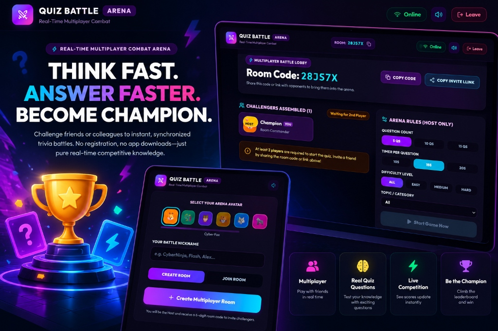

<div align="center">



# ⚔️ Quiz Battle Arena

### High-Performance, Real-Time Multiplayer Trivia Engine

[](https://quiz-battel-arena.vercel.app/)
[](https://github.com/Chandra142/Quiz-Battel-Arena)
[](https://opensource.org/licenses/MIT)

[](https://react.dev/)
[](https://www.typescriptlang.org/)
[](https://nodejs.org/)
[](https://socket.io/)
[](https://tailwindcss.com/)
[](https://vitejs.dev/)

<p align="center">
  <b>Think Fast. Answer Faster. Become the Champion.</b><br>
  A production-grade, low-latency multiplayer quiz game where players host private rooms, share instant invite codes, and battle head-to-head with synchronized timers, server-authoritative scoring, and procedural audio.
</p>

[Live Demo](https://quiz-battel-arena.vercel.app/) • [Architecture](#-system-architecture) • [Features](#-features) • [Getting Started](#-getting-started) • [Deployment](#-deployment) • [API Contract](#-real-time-event-contract)

</div>

---

## 📑 Table of Contents
- [System Architecture](#-system-architecture)
- [Key Engineering Highlights](#-key-engineering-highlights)
- [Features](#-features)
- [Project Structure](#-project-structure)
- [Getting Started](#-getting-started)
- [Environment Configuration](#-environment-configuration)
- [Testing & Quality Assurance](#-testing--quality-assurance)
- [Real-Time Event Contract](#-real-time-event-contract)
- [Deployment Guide](#-deployment-guide)
- [License](#-license)

---

## 🏛 System Architecture

The application implements an **authoritative server model**. The client acts as a reactive presentation layer, while all game state transitions, timer broadcasts, answer validations, and speed bonus calculations are strictly computed on the server.

```mermaid
sequenceDiagram
    autonumber
    actor Host as Player 1 (Host)
    actor Challenger as Player 2 (Challenger)
    participant Server as Node.js Socket.IO Server

    Host->>Server: create_room { nickname, avatarSeed }
    Server-->>Host: room_created { roomCode: "28J57X" }
    
    Challenger->>Server: join_room { roomCode: "28J57X", nickname }
    Server-->>Host: player_joined { challenger }
    Server-->>Challenger: joined_room_success { roomState }

    Host->>Server: start_game { roomCode }
    Server-->>Host: countdown_tick { 3..2..1 }
    Server-->>Challenger: countdown_tick { 3..2..1 }

    rect rgb(20, 16, 40)
        Note over Server,Challenger: Active Round (Answers hidden from payloads)
        Server-->>Host: new_question { questionData (no correctAnswer), timer: 15s }
        Server-->>Challenger: new_question { questionData (no correctAnswer), timer: 15s }
        
        Host->>Server: submit_answer { optionIndex: 2 }
        Server-->>Host: player_answered { locked: true }
        
        Challenger->>Server: submit_answer { optionIndex: 1 }
        Server-->>Challenger: player_answered { locked: true }
    end

    Note over Server: All players locked in early -> trigger instant reveal
    Server-->>Host: reveal_answer { correctAnswer, explanation, scores, leaderboard }
    Server-->>Challenger: reveal_answer { correctAnswer, explanation, scores, leaderboard }
```



### Why Authoritative State?
1. **Zero Client Tampering**: Clients never receive the `correctAnswer` index during the question phase. DevTools inspection cannot reveal the answer.
2. **Server-Side Elapsed Time Scoring**: Speed bonuses are derived from server timestamps (`Date.now() - questionStartTime`), eliminating client clock skew or latency exploitation.
3. **Simultaneous Lifecycle Synchronization**: All connected peers see the same countdown ticks and question reveals simultaneously.

---

## ⚡ Key Engineering Highlights

### 1. Dynamic Scoring Engine
$$\text{Score} = \text{Base (500 pts)} + \text{Speed Bonus (up to 500 pts)} + \text{Streak Bonus (up to 200 pts)}$$
- **Speed Bonus Formula**:
  $$\text{Bonus} = \text{round}\left(500 \times \frac{\text{Remaining Time (ms)}}{\text{Total Question Duration (ms)}}\right)$$
- **Streak Multiplier**: Consecutive correct answers accumulate streak bonuses ($+50\text{ pts}$ per level, capped at $200\text{ pts}$). An incorrect answer immediately resets the streak to 0.

### 2. Procedural Web Audio API Synthesizer
Rather than relying on external `.mp3` or `.wav` assets that can suffer from 404s, CORS rejections, or loading latencies, the game incorporates an in-browser audio synthesis engine (`client/src/services/soundManager.ts`):
- **Click**: Short sine-wave transient ($600\text{ Hz} \to 800\text{ Hz}$).
- **Select / Lock**: Triangle-wave confirmation chord ($440\text{ Hz} \to 660\text{ Hz}$).
- **Clock Tick**: Sharp harmonic pulse ($520\text{ Hz}$ normal / $880\text{ Hz}$ urgent).
- **Correct**: Rising major 7th arpeggio ($C_5, E_5, G_5, C_6$).
- **Incorrect**: Descending discordant sawtooth buzz ($160\text{ Hz} \to 110\text{ Hz}$).
- **Victory**: Multiphonic major fanfare chord.

### 3. Automatic Room Lifecycle & Garbage Collection
- Alphanumeric 6-character room codes generated from a collision-resistant character set (`23456789ABCDEFGHJKLMNPQRSTUVWXYZ`), avoiding confusing characters (`0/O`, `1/I`).
- Abandoned or inactive rooms are automatically garbage-collected after **45 minutes** of inactivity to conserve server memory.

---

## 🌟 Features

- **Instant Lobby Creation**: Create private rooms and share 6-character codes or one-click invite URLs (`/?room=28J57X`).
- **Zero Authentication**: Pick an avatar, choose a callsign, and start playing immediately. Player identities persist in `localStorage`.
- **Configurable Match Rules**: Hosts can customize question counts (5, 10, 15), timer per question (10s, 15s, 20s), difficulty (Easy, Medium, Hard, All), and categories.
- **120-Question Curated Bank**: Questions across General Knowledge, Science, Technology, Sports, History, and Geography.
- **Live Leaderboard & Position Tracking**: Animated position shifts ($\blacktriangle$, $\blacktriangledown$, $-$) and real-time round point differentials ($+850\text{ PTS}$).
- **3D Animated Victory Podium**: Celebrating 1st, 2nd, and 3rd place with crowns, medals, and a full-screen canvas confetti explosion.
- **Instant Rematch ("Play Again")**: Hosts can restart new matches with the existing lobby roster without re-entering codes.
- **Dynamic Backend Server Selector**: In-app modal allowing players on Vercel to connect or switch backend server URLs seamlessly.

---

## 📁 Project Structure

```
Quiz Battle Arena/
├── package.json                   # Root orchestrator scripts
├── README.md                      # Production engineering documentation
├── ARCHITECTURE.md                # System design & protocol specification
├── banner.jpg                     # High-res GitHub preview banner
│
├── server/                        # Node.js + Express + Socket.IO Backend
│   ├── package.json
│   ├── tsconfig.json              # Strict NodeNext configuration
│   ├── src/
│   │   ├── index.ts               # HTTP server & WebSocket bootstrap
│   │   ├── game/
│   │   │   ├── GameRoom.ts        # Room state machine, timer loops, scoring
│   │   │   └── RoomManager.ts     # Room lifecycle & memory cleanup
│   │   ├── questions/
│   │   │   └── questionBank.ts    # 120 curated questions & selector
│   │   ├── socket/
│   │   │   └── socketHandler.ts   # Typed Socket.IO event controllers
│   │   └── types/
│   │       └── index.ts           # Authoritative server contracts
│
└── client/                        # React 19 + TypeScript + Vite Frontend
    ├── package.json
    ├── vite.config.ts             # Vite configuration with Tailwind CSS v4
    ├── index.html                 # SEO tags, Outfit fonts & SVG favicon
    ├── src/
    │   ├── App.tsx                # Dynamic game phase router
    │   ├── index.css              # Dark theme tokens, glassmorphic utilities
    │   ├── context/
    │   │   └── SocketContext.tsx  # Socket client provider & persistent identity
    │   ├── components/
    │   │   ├── Avatar.tsx         # 8 procedural gamer avatars & badges
    │   │   ├── Navbar.tsx         # Connection status, audio toggle & room badge
    │   │   ├── TimerBar.tsx       # Animated circular & linear SVG timer
    │   │   ├── QuestionCard.tsx   # Interactive options, locked & reveal states
    │   │   ├── Leaderboard.tsx    # Live rankings with delta indicators
    │   │   ├── Podium.tsx         # 3D podium, confetti & rematch controls
    │   │   └── ServerConfigModal.tsx # Dynamic backend URL switcher
    │   ├── pages/
    │   │   ├── LandingPage.tsx    # Hero, avatar picker & room forms
    │   │   ├── LobbyPage.tsx      # Roster, host controls & share links
    │   │   ├── GamePage.tsx       # Active HUD, question view & leaderboard
    │   │   └── ResultsPage.tsx    # Final scoreboard wrapper
    │   ├── services/
    │   │   └── soundManager.ts    # Web Audio API sound synthesizer
    │   ├── test-flow.js           # Headless multi-client integration test
    │   └── test-edge-cases.js     # Security & validation test suite
```

---

## 🚀 Getting Started

### Prerequisites
- **Node.js**: v18.0.0 or higher (v20+ recommended)
- **npm**: v9.0.0 or higher

### 1. Clone the Repository
```bash
git clone https://github.com/Chandra142/Quiz-Battel-Arena.git
cd Quiz-Battel-Arena
```

### 2. Install Dependencies
```bash
# Install root, backend, and frontend dependencies
npm run install:all
```

### 3. Configure Environment Variables
Copy the example environment files:

```bash
# Backend
cp server/.env.example server/.env

# Frontend
cp client/.env.example client/.env
```

### 4. Run Development Servers
Open two terminal windows:

```bash
# Terminal 1: Backend Server (Port 3001)
npm run server

# Terminal 2: Frontend Client (Port 5173)
npm run client
```

Navigate to `http://localhost:5173` to play!

---

## ⚙️ Environment Configuration

### Backend (`server/.env`)
| Variable | Default | Description |
|---|---|---|
| `PORT` | `3001` | Port on which the Express & Socket.IO server listens |
| `NODE_ENV` | `development` | Runtime environment (`development` / `production`) |
| `CLIENT_URL` | `http://localhost:5173` | Allowed CORS origin for client WebSocket connections |

### Frontend (`client/.env`)
| Variable | Default | Description |
|---|---|---|
| `VITE_SERVER_URL` | `http://localhost:3001` | Target Node.js backend URL for Socket.IO |

---

## 🧪 Testing & Quality Assurance

The codebase includes automated end-to-end integration tests that simulate multiple players competing over real WebSocket connections:

```bash
# Run headless multiplayer end-to-end flow test
node client/test-flow.js

# Run security, permission & edge-case test suite
node client/test-edge-cases.js
```

### Test Coverage Checklist:
- [x] Host room creation and 6-character code generation.
- [x] Challenger joining and duplicate nickname rejection.
- [x] Minimum 2-player game start enforcement.
- [x] Non-host permission rejection (only host can update settings or start).
- [x] Correct answer omission from question payload during active round.
- [x] Simultaneous answer submissions and double-submission locking.
- [x] Authoritative speed bonus and streak score calculation.
- [x] Early reveal trigger when all active players submit answers.
- [x] Disconnection and host reassignment handling.

---

## 🔌 Real-Time Event Contract

All client-server communication occurs via typed Socket.IO events:

| Event | Source | Direction | Payload Structure | Description |
|---|---|---|---|---|
| `create_room` | Client | $\to$ Server | `{ playerId, nickname, avatarSeed }` | Initializes a new room; sets player as host |
| `join_room` | Client | $\to$ Server | `{ roomCode, playerId, nickname, avatarSeed }` | Joins existing room; validates duplicate names |
| `room_created` | Server | $\to$ Client | `{ roomCode, player, roomState }` | Confirms room creation |
| `joined_room_success` | Server | $\to$ Client | `{ roomCode, player, roomState }` | Confirms room entry |
| `update_settings` | Client | $\to$ Server | `{ roomCode, playerId, settings }` | Host updates question count, timer, or topic |
| `start_game` | Client | $\to$ Server | `{ roomCode, playerId }` | Host starts 3-second countdown |
| `countdown_tick` | Server | $\to$ Room | `{ count }` | 1-second countdown tick |
| `new_question` | Server | $\to$ Room | `{ question, timerSeconds }` | Dispatches question without answer index |
| `submit_answer` | Client | $\to$ Server | `{ roomCode, playerId, optionIndex }` | Locks choice; calculates speed bonus |
| `player_answered` | Server | $\to$ Room | `{ playerId, hasAnswered }` | Broadcasts locked status to peers |
| `timer_update` | Server | $\to$ Room | `{ timerRemaining }` | Broadcasts remaining round seconds |
| `reveal_answer` | Server | $\to$ Room | `{ reveal, leaderboard }` | Reveals answer, point gains, and standings |
| `game_finished` | Server | $\to$ Room | `{ leaderboard, winner }` | Match concluded; displays podium |
| `play_again` | Client | $\to$ Server | `{ roomCode, playerId }` | Host resets match to lobby with current roster |

---

## 🚢 Deployment Guide

### Deploying Backend (Render)
1. In [Render](https://render.com), create a new **Web Service**.
2. Connect your GitHub repository: `Chandra142/Quiz-Battel-Arena`.
3. Set **Root Directory** to: `server`.
4. Set **Build Command**:
   ```bash
   npm install --include=dev && npm run build
   ```
   > *Note: `--include=dev` guarantees TypeScript and `@types/express` are installed during the build phase even when `NODE_ENV=production` is enabled.*
5. Set **Start Command**:
   ```bash
   npm start
   ```
6. Add Environment Variable:
   - `PORT` = `3001`
   - `NODE_ENV` = `production`
7. Copy your deployed service URL (e.g., `https://quiz-battel-arena-server.onrender.com`).

### Deploying Frontend (Vercel)
1. In [Vercel](https://vercel.com), import repository `Chandra142/Quiz-Battel-Arena`.
2. Set **Root Directory** to: `client`.
3. Set **Framework Preset**: `Vite`.
4. Add Environment Variable:
   - `VITE_SERVER_URL` = Your backend Render URL (e.g. `https://quiz-battel-arena-server.onrender.com`).
5. Click **Deploy**.

---

## 📄 License

This project is licensed under the [MIT License](LICENSE). Built for high-performance real-time multiplayer challenges.
